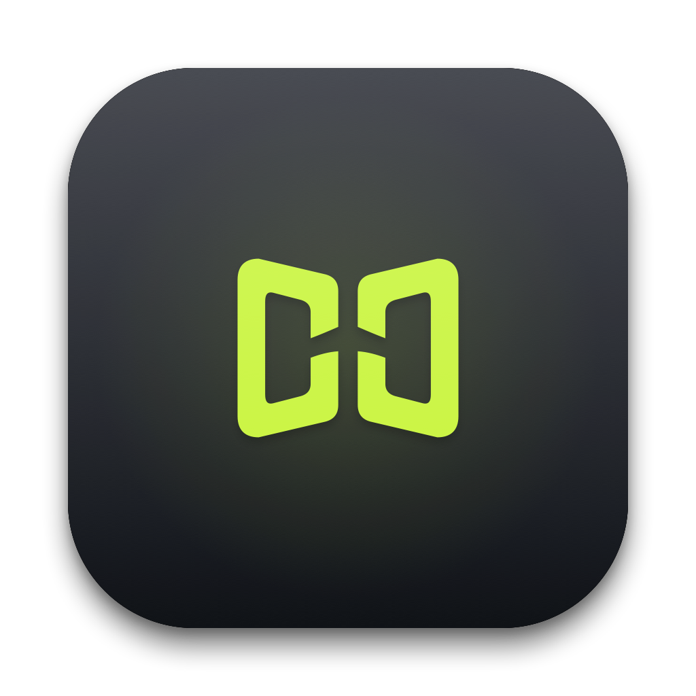
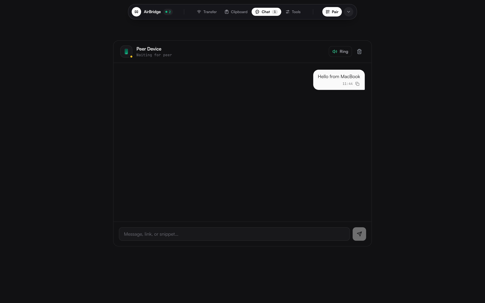

# AirBridge: Cross-Platform Multi-Device Continuity Bridge

<div align="center">



### High-Speed LAN Continuity Bridge for Windows, macOS, Android, iOS, and Linux

*Zero client app installation • Direct gigabit LAN file transfer • Office Wi-Fi PIN security • Live clipboard sync • Universal multi-device mesh*

[](LICENSE)
[](#)
[](https://www.typescriptlang.org/)
[](https://react.dev/)
[](https://tailwindcss.com/)

<br />

| Dark Mode (Obsidian & Electric Lime) | Light Mode (Clean Bento) |
|:---:|:---:|
|  |  |

| Direct LAN Peer Chat | Website-Grade Confirmation Modals |
|:---:|:---:|
|  |  |

</div>

---

## Overview

In modern office and home environments, teams often work across diverse operating systems: Windows desktop PCs, MacBooks, Android devices, iPhones, and Linux workstations. Transferring large nested folders, sharing code archives, or copying text across devices usually means uploading to slow cloud storage, sending files via chat apps, or struggling with proprietary AirDrop limitations that exclude Windows and Android.

AirBridge solves this friction. It runs a native host daemon on Windows, macOS, or Linux, and connects all local devices over high-speed local Wi-Fi or Ethernet. Devices connect instantly via browser without installing native client apps.

- **Cross-Platform Mesh**: Seamlessly transfer files and text between Windows PCs, MacBooks, Android smartphones, iPhones, and Linux systems.
- **Zero Client App Installation**: Any smartphone, tablet, or desktop connects instantly by scanning a QR code or visiting the local LAN address.
- **High-Speed Local LAN Transfer**: Files stream directly over local gigabit Wi-Fi or Ethernet at wire speed (50 to 100+ MB/s), completely bypassing cloud quotas and external bandwidth caps.
- **Office Room PIN Security**: In shared office Wi-Fi networks where multiple computers and guests share the same subnet, an optional 4-digit Room PIN ensures only authorized team members can access the shared vault.
- **Full Recursive Folder Beaming**: Drag and drop nested directories (1,000+ files) with full folder hierarchies preserved on disk.
- **Native File Manager Integration**: Reveal beamed files directly in Windows File Explorer (`explorer.exe /select,`), macOS Finder (`open -R`), or Linux file managers.
- **100% Private & Direct**: All traffic remains strictly within your local network. Zero cloud relays, zero third-party telemetry.
- **Always-On Background Service**: Includes Windows autostart service (`install-service-windows.bat`) and macOS `launchd` daemon (`install-service.sh`) consuming under 25MB RAM.

---

## Core Capabilities

### 1. Multi-Device LAN File & Folder Sharing
- **Recursive Folder Engine**: Preserves complete directory trees during upload and download.
- **Large File Streaming**: Resumable chunked pipeline reliably beams multi-gigabyte video archives and ISO images up to 10GB+.
- **Vault Archive**: Grid and list views with file previews, on-demand ZIP archive compilation, single-file downloads, and instant delete confirmations.
- **Native OS Reveal**: Click Explorer on Windows or Finder on macOS to highlight files directly in their folder.

### 2. Office Wi-Fi Security & Room PIN Protection
- **Subnet Privacy**: Protects your shared files and clipboard from unauthorized devices on shared office or co-working Wi-Fi networks.
- **4-Digit Room PIN**: Host machines can enable Room PIN protection with one click.
- **Zero-Friction Camera Pairing**: The host pairing QR code automatically embeds the secure PIN token, allowing mobile cameras to authenticate seamlessly upon scanning.
- **Brute-Force Rate Limiting**: Dedicated rate limiting on authentication endpoints stops automated subnet probing.

### 3. Universal Live Clipboard & Two-Way Messaging
- **Instant Clipboard Sync**: Text, URLs, code snippets, or tokens copied on any connected device sync immediately via WebSockets.
- **Peer Chat 2.0**: Two-column bento messenger with hardware telemetry (peer device presence, latency metrics, battery levels) and link preview cards.
- **Remote URL Launch**: Beam any web address from your mobile device to open directly in your computer default browser.

### 4. Hardware Remote Tools
- **Find My Phone**: Trigger haptic vibration patterns on connected Android devices.
- **Host Ping Alert**: Send an acoustic chime to your host computer (using Windows console tone or macOS alert).
- **Battery Telemetry**: Real-time host battery reporting via Windows CIM (`Win32_Battery`) and macOS `pmset`.

---

## Getting Started

### System Requirements
- **Host Operating System**: Windows 10/11 (64-bit), macOS 12+ (Apple Silicon or Intel), or Linux (Ubuntu, Debian, Fedora, Arch).
- **Node.js**: v18.0 or newer.
- **Network**: All devices connected to the same local Wi-Fi router, office LAN switch, or mobile hotspot.

---

### Step 1: Installation

```bash
# Clone the repository
git clone https://github.com/ursishant/airbridge.git
cd airbridge

# Install dependencies and build production frontend
npm run setup
```

---

### Step 2: Running AirBridge

#### On Windows

**Option A: 24/7 Background Service (Recommended)**
```cmd
install-service-windows.bat
```
- Automatically registers AirBridge in the Windows Startup folder.
- Runs silently in the background consuming under 25MB RAM.
- To uninstall: run `uninstall-service-windows.bat`.

**Option B: Interactive Launcher (Command Prompt or PowerShell)**
```cmd
start.bat
```
Or with PowerShell:
```powershell
.\start.ps1
```

#### On macOS & Linux

**Option A: 24/7 Background Daemon (macOS)**
```bash
./install-service.sh
```
- Runs via native macOS `launchd`.
- To uninstall: run `./uninstall-service.sh`.

**Option B: Interactive Launcher**
```bash
./start.sh
```
Or directly:
```bash
npm start
```

---

### Step 3: Pairing Devices in the Office

1. On your host computer, open `http://localhost:5050` and view the pairing QR code.
2. Scan the QR code with any mobile camera (Android Camera, Google Lens, or iOS Camera).
3. For other office laptops or desktop PCs, enter the displayed LAN IP (e.g., `http://192.168.1.42:5050`) in any modern web browser.
4. If Office Room PIN protection is active, peers enter the 4-digit PIN (or join automatically via the camera QR scan).

---

## File Storage Locations

- **Windows**: `%USERPROFILE%\Downloads\AirBridge` (or fallback to `./uploads`)
- **macOS**: `~/Downloads/AirBridge`
- **Linux**: `~/Downloads/AirBridge`

---

## System Architecture

```
+-------------------------------------------------------------------+
|                        Local Wi-Fi / LAN                          |
+-------------------------------------------------------------------+
        |                          |                         |
        v                          v                         v
+------------------+      +------------------+      +------------------+
|   Windows PC     |      |    MacBook       |      | Android / iPhone |
|  Host or Client  |      |  Host or Client  |      |   Mobile Client  |
|  (File Explorer) |      | (macOS Finder)   |      |  (Chrome/Safari) |
+------------------+      +------------------+      +------------------+
        |                          |                         |
        +--------------------------+-------------------------+
                                   |
                                   v
        +----------------------------------------------------+
        |            AirBridge High-Speed Core               |
        |  - Express / Node.js Engine                        |
        |  - Multi-Client WebSocket Mesh (Up to 50 Peers)    |
        |  - Resumable Chunked Streamer (10GB+ files)        |
        |  - Office Room PIN Authorization Gate              |
        |  - Native OS Explorer / Finder Integration         |
        +----------------------------------------------------+
```

- **Frontend**: React 19, TypeScript, Tailwind CSS, Framer Motion, Lucide Icons.
- **Backend**: Node.js, Express, WebSocket (`ws`), Multer, Archiver.
- **Security**: Rate limiting, CWE-22 strict path containment, argument array process execution.

---

## Security Model

1. **Subnet-Level Isolation**: Direct peer-to-peer traffic stays on the local network without routing through public cloud servers.
2. **Office Room PIN**: Prevents unauthorized devices on shared office subnets from viewing, downloading, or uploading files.
3. **Path Traversal Containment**: All file operations validate that resolved paths strictly start with the designated uploads directory boundary.
4. **Shell Injection Prevention**: All system process invocations (`explorer.exe`, `open`, `xdg-open`, `rundll32.exe`) use isolated argument arrays without shell interpolation.
5. **Brute-Force Rate Limiting**: Dedicated rate limiting on the PIN authentication route mitigates automated guessing attacks.

---

## Keyboard Shortcuts

| Key | Function |
|:---|:---|
| `Enter` | Send message in Peer Chat |
| `Escape` | Close any active modal dialog |
| `Ctrl + V` / `Command + V` | Paste and beam clipboard directly |

---

## Contributing

Contributions and feedback are welcome:

1. Fork the repository
2. Create your feature branch (`git checkout -b feature/improvement`)
3. Commit your changes (`git commit -m 'feat: improve folder streaming'`)
4. Push to the branch (`git push origin feature/improvement`)
5. Open a Pull Request

---

## License

Distributed under the **MIT License**. See [LICENSE](LICENSE) for details.
