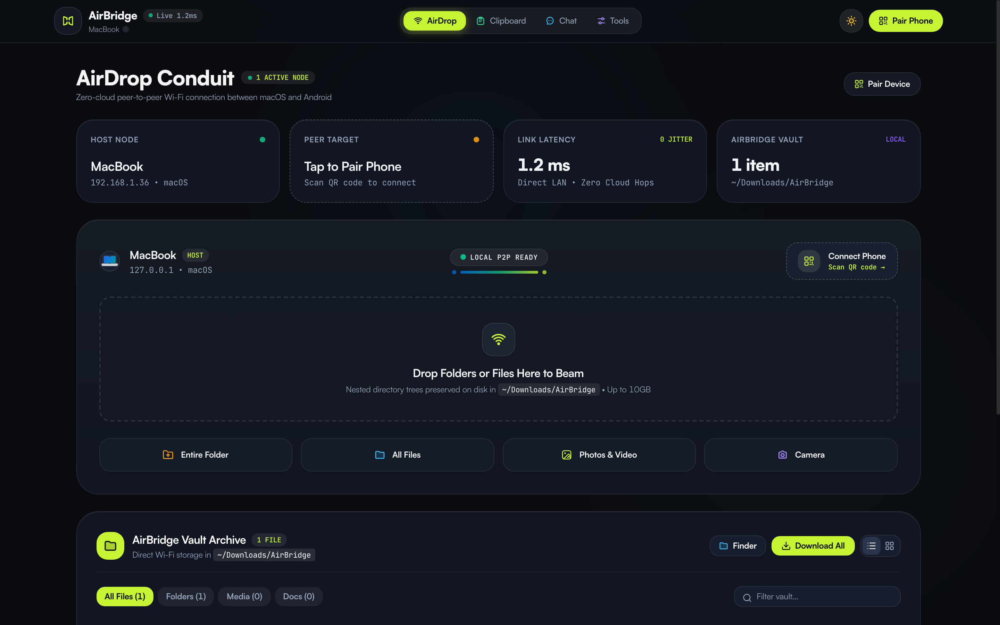
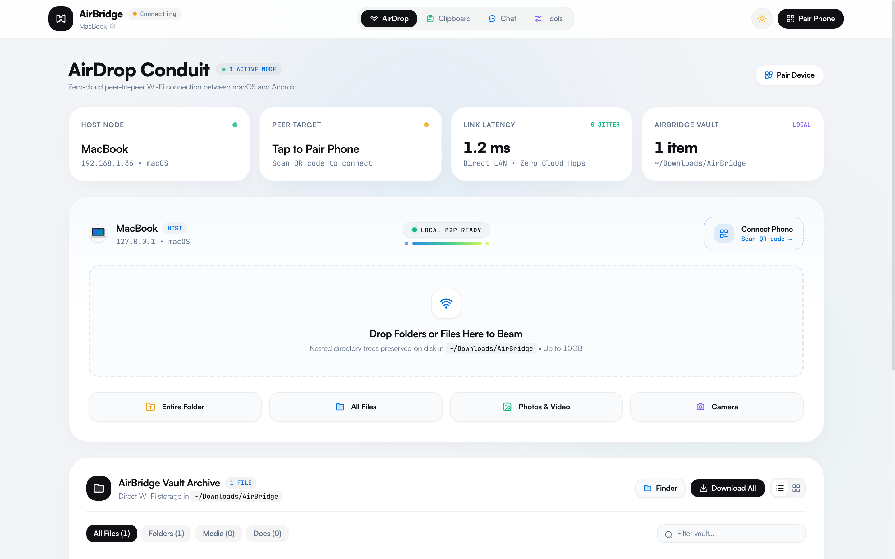
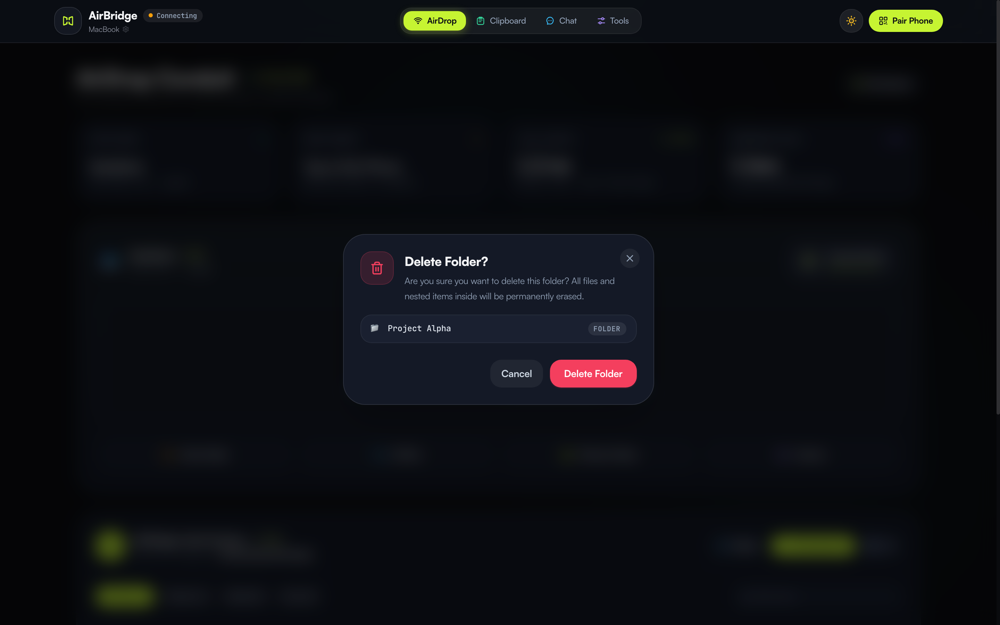
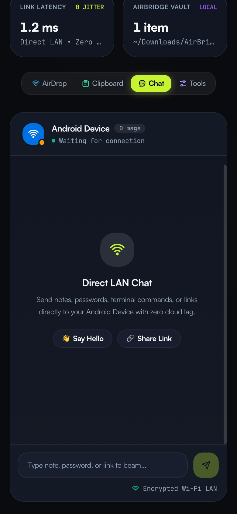
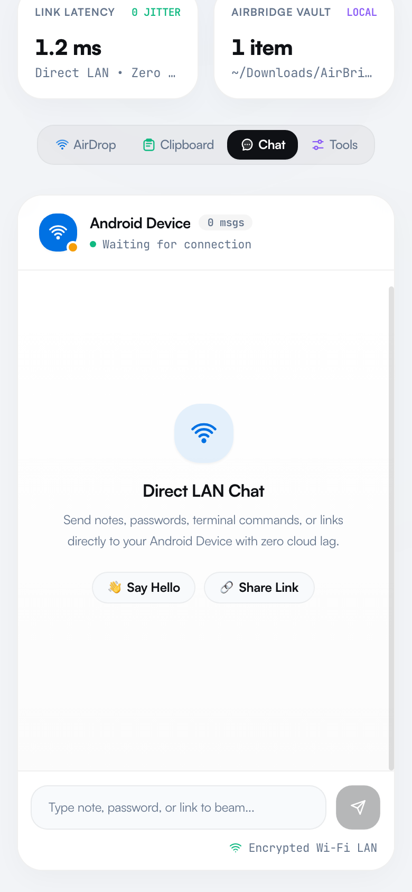

# AirBridge • macOS to Android Zero-Friction Bridge

<div align="center">


### The Open-Source Continuity Bridge for macOS and Android Over Local Wi-Fi

*Zero Android app installation • Full recursive directory beaming • Live clipboard sync • Direct LAN P2P*

[](LICENSE)
[](#)
[](https://www.typescriptlang.org/)
[](https://react.dev/)
[](https://tailwindcss.com/)

<br />

| Dark Mode (Obsidian & Electric Lime) | Light Mode (Clean Bento) |
|:---:|:---:|
|  |  |

| Direct LAN Peer Chat | Website-Grade Confirmation Modals |
|:---:|:---:|
|  |  |

</div>

---

## Overview

Apple's AirDrop and Continuity ecosystem provides seamless cross-device sharing, but stops short when you use an Android device alongside a Mac. Transferring large nested folders, syncing clipboard text, or beaming links between macOS and Android typically requires third-party cloud services, messaging yourself on chat apps, or connecting physical USB cables.

AirBridge solves this friction cleanly. It runs a native, ultra-lightweight daemon on macOS and serves an authentic, modern web application to your Android device over your local Wi-Fi network.

- **Zero Android App Installation** — Scan the pairing QR code with your phone camera to instantly connect.
- **Full Recursive Folder Beaming** — Drag and drop entire folders (1,000+ nested files) with directory structures preserved in `~/Downloads/AirBridge`.
- **100% Private & Direct** — All traffic stays strictly on your local Wi-Fi network with sub-2ms latency. Zero cloud intermediaries.
- **Completely Silent** — Clean visual notifications with zero unwanted sounds or audio interruptions.
- **Website-Grade Dialogs** — Polished, custom-rendered confirmation modals with zero browser alert popups.
- **Always-On Background Service** — Runs via native macOS `launchd` consuming under 20MB RAM with zero terminal windows required.

---

## Core Capabilities

### 1. AirDrop-Style Folder and File Beaming
- **Directory Hierarchy Preserved**: Beaming folders recreates nested paths directly on disk in `~/Downloads/AirBridge`.
- **Large File Streaming**: High-throughput chunked upload pipeline effortlessly transfers multi-gigabyte files and video archives.
- **Vault Archive**: Dual-mode grid/list file browser with thumbnail previews, on-demand ZIP packaging, and direct Finder integration.

### 2. Peer Chat 2.0 (LAN Messenger)
- **Responsive Two-Column Bento Layout**: Includes hardware telemetry (peer device presence, latency metrics, battery status) and quick preset beamers.
- **Streamlined Message Bubbles**: Outgoing messages feature Electric Lime and Dark Obsidian styling with timestamps and one-click copy.
- **Smart Link Previews**: Shared URLs automatically generate clean preview cards with open-in-browser shortcuts.

### 3. Universal Live Clipboard
- **Instant Bidirectional Sync**: Text, URLs, phone numbers, or code snippets copied on either device sync immediately over WebSockets.
- **One-Tap Actions**: Copy text with instant visual feedback, open links on Mac, or dial phone numbers directly on Android.

### 4. Hardware Remote Tools
- **Find My Phone**: Trigger haptic vibration patterns on your Android device to locate it nearby.
- **Remote Mac Ping**: Send a test signal directly to your Mac.
- **Remote URL Launch**: Beam any web page from Android to open directly in your Mac's default browser.

### 5. Dual-Theme Interface
- **Obsidian Dark Mode**: High-contrast architecture with Electric Lime accents (`#C6F432`) and deep slate backgrounds.
- **Clean Light Mode**: Pure white bento cards with slate grey backgrounds and obsidian text.
- **Typography**: Responsive system typography designed for readability across mobile and desktop viewports.

---

## Mobile Experience

<div align="center">

| Mobile Dark Mode | Mobile Light Mode |
|:---:|:---:|
|  |  |

</div>

---

## Getting Started

### Requirements
- **macOS**: Monterey 12.0 or newer (Apple Silicon M1/M2/M3/M4 and Intel)
- **Node.js**: v18.0 or newer
- Both your Mac and Android device connected to the **same Wi-Fi network** (or Mac Personal Hotspot).

---

### Step 1: Installation

```bash
# Clone the repository
git clone https://github.com/ursishant/airbridge.git
cd airbridge

# Install dependencies and build production bundle
npm run setup
```

---

### Step 2: Running AirBridge

#### Option A: Background Daemon (Recommended)
Run AirBridge automatically in the background 24/7 without keeping a terminal window open:

```bash
./install-service.sh
```

- Starts automatically on macOS user login.
- Runs silently in the background consuming less than 20MB of memory.
- Open anytime in your browser at `http://localhost:5050`.

To uninstall the background service:
```bash
./uninstall-service.sh
```

#### Option B: Foreground Mode (Testing and Development)
```bash
npm start
```

---

### Step 3: Pairing Devices

1. On your Mac, open `http://localhost:5050` and click **Pair Phone** (or view the terminal QR code).
2. Scan the QR code using your Android camera or Google Lens.
3. Tap the link to open AirBridge in Chrome.
4. *(Optional)* Tap **Add to Home screen** in Chrome to install AirBridge as a standalone Progressive Web App (PWA).

---

### Step 4: Transferring Files and Folders

- **Send to Mac**: Drag and drop any folder or file onto your phone browser, or tap **Entire Folder** / **All Files**. Items appear immediately in `~/Downloads/AirBridge`.
- **Send to Android**: On your Mac, drag files onto the drop zone. On your phone, tap **Download** or **Get ZIP**.
- **Delete Items**: Click the trash button on any item. AirBridge displays a custom in-app confirmation modal and deletes the item from disk without browser alert prompts.

---

## System Architecture

```
+---------------------------------+                       +---------------------------------+
|           macOS Host            |      Local Wi-Fi      |         Android Device          |
|       (Node.js / Express)       | <-------------------> |      (PWA / Mobile Chrome)      |
|                                 |      WebSockets       |                                 |
|  - Recursive Folder Engine      |                       |  - Folder Drop Zone & Tree Pack |
|  - Multer / Archiver Streaming  |      HTTP / REST      |  - Live Clipboard Engine        |
|  - WebSocket Real-Time Broker   | <-------------------> |  - LAN Peer Messenger           |
|  - Native launchd Daemon        |                       |  - Hardware Remote Controller   |
+---------------------------------+                       +---------------------------------+
```

- **Frontend**: React 19, TypeScript, Tailwind CSS, Framer Motion, Lucide Icons.
- **Backend**: Node.js, Express, WebSocket (`ws`), Multer, Archiver.
- **Networking**: Direct peer-to-peer LAN connection via local IP over Wi-Fi.

---

## Keyboard Shortcuts

| Key | Function |
|:---|:---|
| `Enter` | Send message in Peer Chat |
| `Escape` | Close any active modal dialog |
| `Command + V` | Paste and beam clipboard directly |

---

## Contributing

Contributions and feedback are welcome:

1. Fork the repository
2. Create your feature branch (`git checkout -b feature/improvement`)
3. Commit your changes (`git commit -m 'feat: improve folder streaming'`)
4. Push to the branch (`git push origin feature/improvement`)
5. Open a Pull Request

---

## License

Distributed under the **MIT License**. See [LICENSE](LICENSE) for details.
